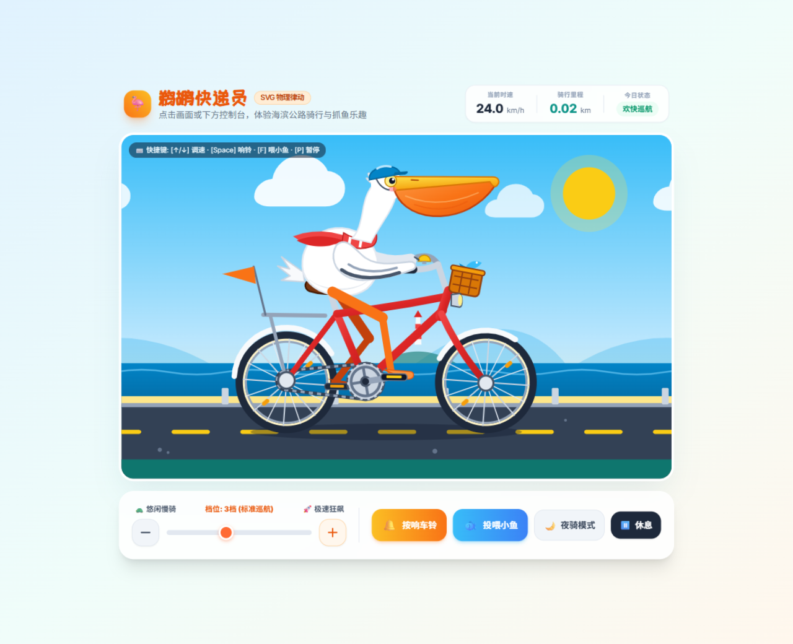
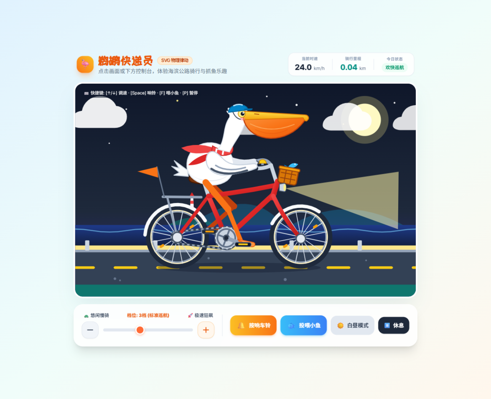

# Gemini 的鹈鹕测试 🦩🚲

> 一个提示词，一只会骑车的鹈鹕 —— 单文件 HTML 交互式 SVG 动画。



这是用来测试 Gemini 3 生成能力（"鹈鹕测试" / pelican test）的单文件作品：一只戴头盔、围红围巾的鹈鹕，在海滨公路上骑复古红色自行车。整页零依赖框架、零构建、零图片资源 —— 全部由手写 SVG 路径、CSS 渐变和原生 JavaScript 驱动。

## 在线体验

直接用浏览器打开 `index.html` 即可，不需要安装任何东西。

```bash
# 方式一：双击 index.html

# 方式二：起个本地服务（推荐，避免个别浏览器的跨域限制）
python -m http.server 8000
# 然后访问 http://127.0.0.1:8000
```

## 夜间模式



点击「夜骑模式」切换：天空、海面、太阳都换成月亮与星空，车头大灯亮起光束，路灯氛围随之一变。

## 交互说明

| 操作 | 快捷键 | 效果 |
| --- | --- | --- |
| 调速 | `↑` `↓` `←` `→` | 0–3 倍的档位无级变速，速度平滑插值 |
| 按铃 | `Space` / 点击画面 | 车铃震动 + 声波扩散 + Web Audio 合成的"叮铃铃" |
| 喂鱼 | `F` | 小鱼从海面跃起，抛物线飞进大嘴，喉囊果冻般晃动 |
| 暂停 | `P` | 驻车看海，仪表归零 |

底部控制台还提供档位滑块、加减速按钮、昼夜切换和暂停按钮。

## 技术要点

- **2-Bone IK 逆运动学**：鹈鹕的双腿不是预先画好的动画帧，而是每帧根据踏板位置实时解算膝盖关节坐标（余弦定理 + 关节角度钳制），保证踩踏时膝盖永远朝正确方向弯曲。
- **踏板与车轮同步**：曲柄角速度与车轮角速度按齿比绑定，链条虚线偏移、牙盘旋转、双腿相位差 180° 全部由同一个 `pedalAngle` 推导。
- **弹簧次级运动**：头部、喉囊、尾巴、围巾相位滞后于车身，形成果冻般的跟随感；吞鱼后喉囊还有独立的衰减振荡。
- **多层视差**：云 → 远山灯塔 → 海浪 → 路面虚线 → 护栏石子，五层不同速度滚动，停车时仍有微风吹拂。
- **纯代码音频**：车铃和吞鱼音效由 `OscillatorNode` + 指数衰减包络实时合成，没有音频文件。
- **无外部图片**：整只鹈鹕、自行车、灯塔、云朵都是内联 SVG 路径。

依赖只有一个：Tailwind 的 CDN 脚本（`cdn.tailwindcss.com`）用于页面布局和控件样式。离线时布局会退化，但 SVG 动画本身照常运行。

## 文件结构

```
.
├── index.html              # 全部源码（HTML + SVG + CSS + JS，单文件）
├── docs/
│   ├── preview-day.png     # README 预览图（白天）
│   └── preview-night.png   # README 预览图（夜间）
└── README.md
```

## 许可

MIT，见 [LICENSE](LICENSE)。
